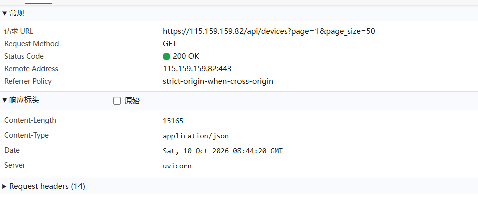
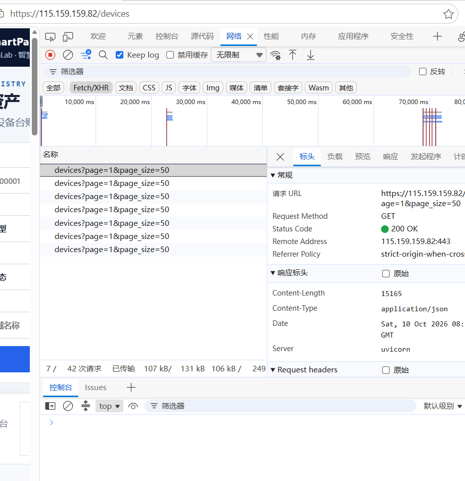
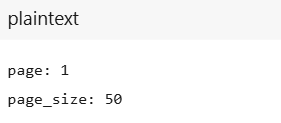
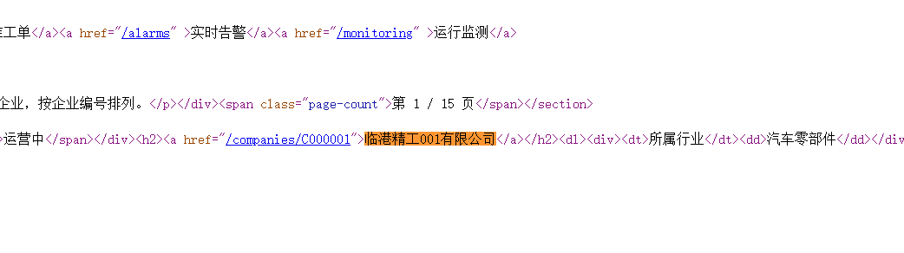
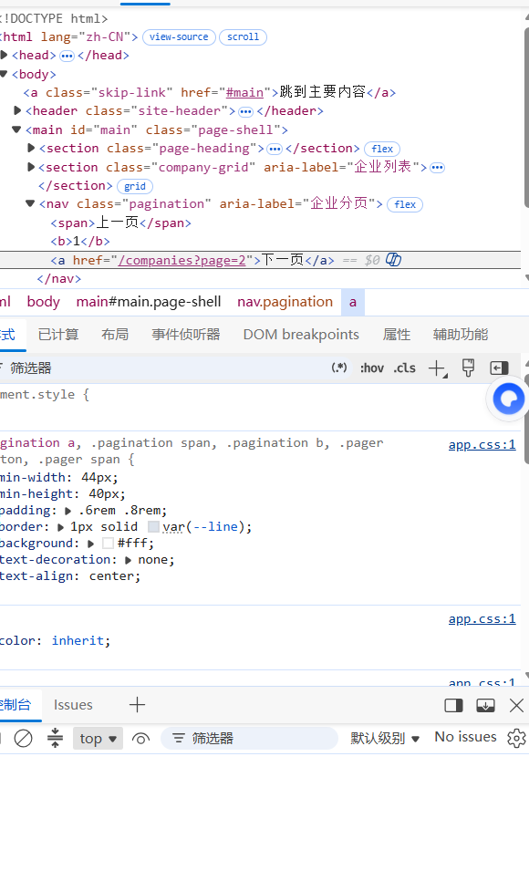
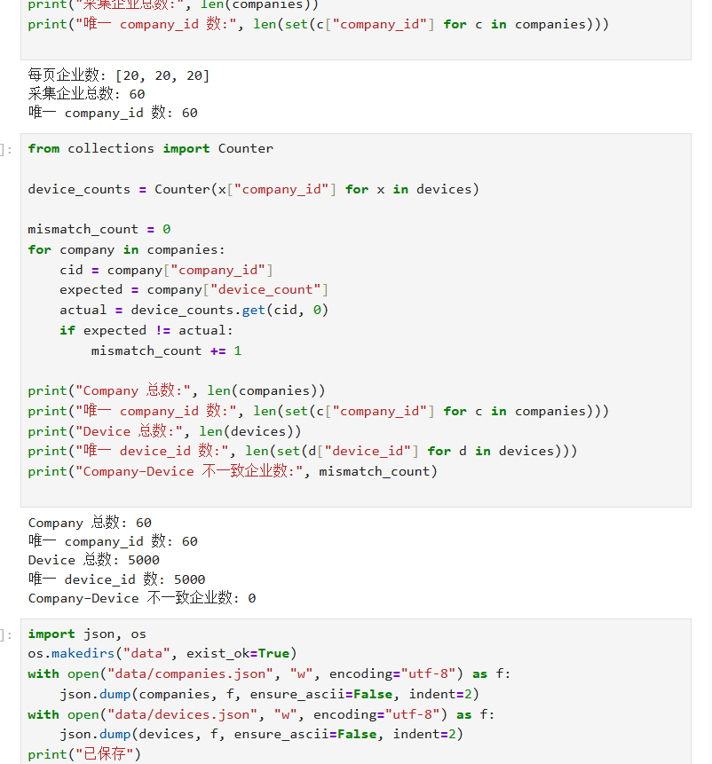

# Lab 1 实验报告

## 学生信息

- **姓名：** 王达康
- **学号：** 112404260133
- **班级：** 数据1241
- **GitHub 用户名：** wangdakang-data
- **仓库地址：** https://github.com/wangdakang-data/bigdata-collection-labs-112404260133

> 文件位置：`lab01/REPORT.md`  
> 完整代码保存在 `lab1_html_api.ipynb`。  
> 本报告只填写关键发现、关键代码、结果和指定截图，**不要把整份 Notebook 复制进来**。

---

# 任务 1：判断数据加载方式

## 1.1 Device：判断动态加载并找到 API

### 判断结果

- 页面：`/devices`
- 数据加载方式：`动态加载`
- 判断依据：

1. 在“查看网页源代码”中搜索页面第一行的设备名称 `循环泵-000001-001`，**搜索不到**（0/0），说明设备数据不在服务器返回的初始 HTML 中；
2. 在 Network 的 Fetch/XHR 中找到请求 `devices?page=1&page_size=50`，其响应为 JSON（`Content-Type: application/json`，200 OK）并返回设备列表，因此判定为**动态加载**。

### API 信息

- Request URL：`https://115.159.159.82/api/devices`
- Request Method：`GET`
- Query 参数：`page`、`page_size`（示例：`?page=1&page_size=50`）

### 【截图 1】Device API 发现证据

文件名：

```text
images/01_device_api.png
```

**截图内容必须是浏览器 DevTools，不是 Jupyter 代码。**

截图中应能看清：

1. 浏览器的 **Network** 面板；
2. 已选中真正返回设备列表的 Fetch/XHR 请求；
3. 右侧 **Headers** 中的 Request URL；
4. Query String Parameters（或 URL 中的分页参数）。

> 不要截整个桌面；尽量裁剪到 Network 请求和右侧 Headers 区域。

**已插入（主图：右侧 Headers，含完整 Request URL、Method、200 OK、Query 分页参数）：**



**补充证据 1：Network 请求列表中该 Fetch/XHR 请求处于选中状态**



**补充证据 2：Query String Parameters（page / page_size）**



---

## 1.2 Company：判断静态加载

- 页面：`/companies`
- 数据加载方式：`静态加载`
- 判断依据：

使用“右键 → 查看网页源代码”后，在源代码中按 `Ctrl + F` 搜索页面真实显示的企业名称 `临港精工001有限公司`，**能直接搜索到**，并且能看到完整的 `<article class="company-card" data-company-id="C000001">…</article>` 记录，说明企业数据随 HTML 一起返回，因此判定为**静态加载**。

### 【截图 2】Company 静态加载证据

文件名：

```text
images/02_company_source.png
```

**截图内容必须是“查看网页源代码”页面，不是 Elements，也不是 Jupyter。**

截图中应能看清：

1. 浏览器正在显示 `/companies` 的网页源代码；
2. 使用 `Ctrl + F` 搜索一个页面中真实存在的企业名称；
3. 源代码中能看到该企业名称或对应企业记录。

**已插入（查看网页源代码中 `临港精工001有限公司` 被高亮命中）：**



---

# 任务 2：Device API 分页采集

## 2.1 API 分页结构

填写你实际从 JSON 中观察到的字段：

| 含义 | JSON 字段 |
|---|---|
| 当前页 | `page` |
| 每页条数 | `page_size` |
| 设备总数 | `total` |
| 设备列表 | `items` |

---

## 2.2 关键代码

只填写分页采集的核心部分，不要粘贴整个 Notebook。

```python
# 从第一页响应中读取分页信息
total = data["total"]
page_size = data["page_size"]

total_pages = (total + page_size - 1) // page_size

devices = []

for page in range(1, total_pages + 1):
    r = requests.get(
        api_url,
        params={
            "page": page,
            "page_size": page_size
        },
        verify=False,
        timeout=10
    )

    page_data = r.json()
    page_items = page_data["items"]
    devices.extend(page_items)
```

---

## 2.3 采集结果

- 每页条数：50
- 设备总数：5000
- 程序计算得到的总页数：100
- 最终采集设备数：5000
- 唯一 `device_id` 数：5000

回答：

> 为什么总页数应由 API 返回的 `total` 和 `page_size` 计算，而不是直接在代码里写死？

答：因为接口返回的数据总量会变化（设备新增或减少后 `total` 不再是 5000）。若把页数写死为 100，数据变多时会**漏采**后面的记录，数据变少时又会请求到空页。用 `(total + page_size - 1) // page_size` 向上取整计算，程序可自动适配任意数据量。

---

# 任务 3：Company HTML 解析

## 3.1 企业记录 Selector

- 企业记录 selector：`article.company-card`
- 第 1 页企业记录数：20

说明为什么选择这个 selector：

- 主要使用了 `id / class / data-* / 父子层级` 中的哪一种？—— **class**（`company-card`），并配合标签名 `article` 缩小范围。
- 是否参考过浏览器 Copy selector 或 AI？—— 先通过「查看网页源代码」观察结构，确认每条企业记录都是 `<article class="company-card">`，直接采用这个 class。
- 最终为什么采用现在这个写法？—— `company-card` 这个 class 在整页中只用于企业卡片，`<article>` 保证取到的是记录级节点而不会误取卡片内部元素；相比浏览器 Copy selector 自动生成的长路径更简洁、更稳定，可读性也更好。

---

## 3.2 关键代码

只填写“记录定位 + 一条记录的关键字段”。

```python
cards = soup.select("article.company-card")

card = cards[0]

company_id = card.get("data-company-id")
name = card.select_one("h2 a").get_text(strip=True)
status = card.select_one(".badge").get_text(strip=True)
```

行业、区域、设备数量使用 `dt/dd` 结构后，请写出你最终如何得到：

```python
# 先把 dl 下每组的 dt（键）/ dd（值）收进字典
details = {}
for item in card.select("dl > div"):
    details[item.select_one("dt").get_text(strip=True)] = \
        item.select_one("dd").get_text(strip=True)

industry = details["所属行业"]
zone = details["所在区域"]
device_count = int(details["设备数量"].replace(" 台", ""))
```

---

## 3.3 字段来源说明

任选 **2 个字段**说明：

1. 字段：`company_id`
   - 来自：`HTML 属性`
   - 使用的方法：`card.get("data-company-id")`，读取 `<article>` 标签上的 `data-company-id` 属性值。

2. 字段：`device_count`
   - 来自：`文本`
   - 使用的方法：`int(details["设备数量"].replace(" 台", ""))`，先取 `<dd>` 的文本「6 台」，去掉「 台」单位后转成整数，方便后面做数值比较。

---

# 任务 4：Company “下一页”分页

## 4.1 下一页元素

- “下一页” selector：`nav.pagination a:last-of-type`
- 第 1 页 `href` 示例：`/companies?page=2`

> 说明：第 1 页的「上一页」是 `<span>`（不是链接），分页栏只有 1 个 `<a>`；从第 2 页起变为「上一页 + 下一页」2 个 `<a>`。若用 `nav.pagination a` 会在第 2 页取到「上一页」，故改用 `:last-of-type` 稳定取到最后一个链接（下一页）。

### 【截图 3】Company “下一页”元素

文件名：

```text
images/03_company_next.png
```

**截图内容必须是浏览器 DevTools 的 Elements 面板。**

截图中应能看清：

1. 页面底部“下一页”对应的 `<a>` 元素被选中；
2. 该元素的 `class`、`href` 等关键属性；
3. 能判断你为什么使用当前 selector。

> 不需要截 Python 代码；这一张图只证明你找到了正确的 DOM 元素。

**已插入（Elements 中底部「下一页」`<a href="/companies?page=2">` 被选中）：**



---

## 4.2 关键代码

```python
next_link = soup.select_one("nav.pagination a:last-of-type")

next_href = next_link["href"]

next_url = urljoin(
    current_url,
    next_href
)
```

再用 2～3 句话说明：

> 你的程序如何完成“当前页 → 找下一页 href → 请求下一页 → 再解析”的循环？

答：程序用 `current_url` 记录当前页地址，先请求并解析出本页的企业记录；然后从分页栏取出「下一页」的 `href`，用 `urljoin` 拼成绝对地址并赋给 `current_url`；下一轮循环再请求这个新地址、继续解析，直到取不到「下一页」或已采集满 3 页为止。

---

## 4.3 三页采集结果

| 页码 | 企业数 |
|---|---:|
| 1 | 20 |
| 2 | 20 |
| 3 | 20 |
| **合计** | 60 |

- 唯一 `company_id` 数：60

---

# 任务 5：结果验证

## 5.1 最终结果

| 检查项 | 结果 |
|---|---:|
| Company 总数 | 60 |
| 唯一 `company_id` | 60 |
| Device 总数 | 5000 |
| 唯一 `device_id` | 5000 |
| Company–Device 不一致企业数 | 0 |

### 【截图 4】最终验证结果

文件名：

```text
images/04_validation.png
```

**已插入：**



---

## 5.2 一致性检查关键代码

只填写最关键的比较逻辑：

```python
from collections import Counter

device_counts = Counter(
    x["company_id"] for x in devices
)

mismatch_count = 0

for company in companies:
    cid = company["company_id"]
    expected = company["device_count"]
    actual = device_counts.get(cid, 0)

    if expected != actual:
        mismatch_count += 1
```

回答：

> 为什么 `status_code == 200` 仍然不能说明“数据已经采集正确”？

答：`200` 只代表这一次 HTTP 请求被服务器成功处理，并不保证返回的数据完整、不重复或与页面一致。例如分页参数写错会只拿到部分数据、去重失败会产生重复记录，这些情况下状态码仍然是 200。所以还要用唯一 `id` 去重计数，并把「企业声明的设备数量」与「实际采集到的设备数量」逐企业比对，才能确认采集结果正确。

---

# 任务 6：保存采集结果

确认已经生成：

```text
data/companies.json
data/devices.json
```

填写：

- `companies.json`：`已生成`
- `devices.json`：`已生成`

不需要截图 JSON 全文，也不需要把 JSON 内容复制到报告。

---

# 实验结论

用 **80～150 字**总结：

答：静态页面 `/companies` 可直接请求 HTML，再用 BeautifulSoup 按 `article.company-card` 解析；动态页面 `/devices` 初始 HTML 没有数据，必须先定位 `/api/devices` 接口，按 `page`、`page_size` 分页取 JSON。HTML 分页要自己找「下一页」`href` 逐页翻，API 分页只需改 `page` 参数。验证时用唯一 `company_id`、`device_id` 计数查重，并把企业声明的设备数与实际采集数逐企业比对，最终不一致为 0。
