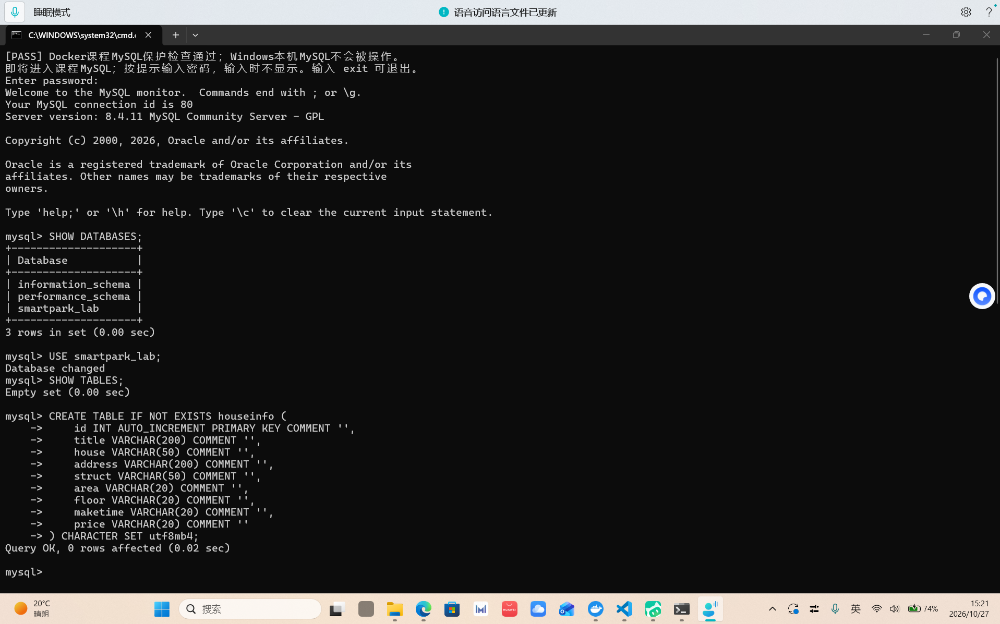
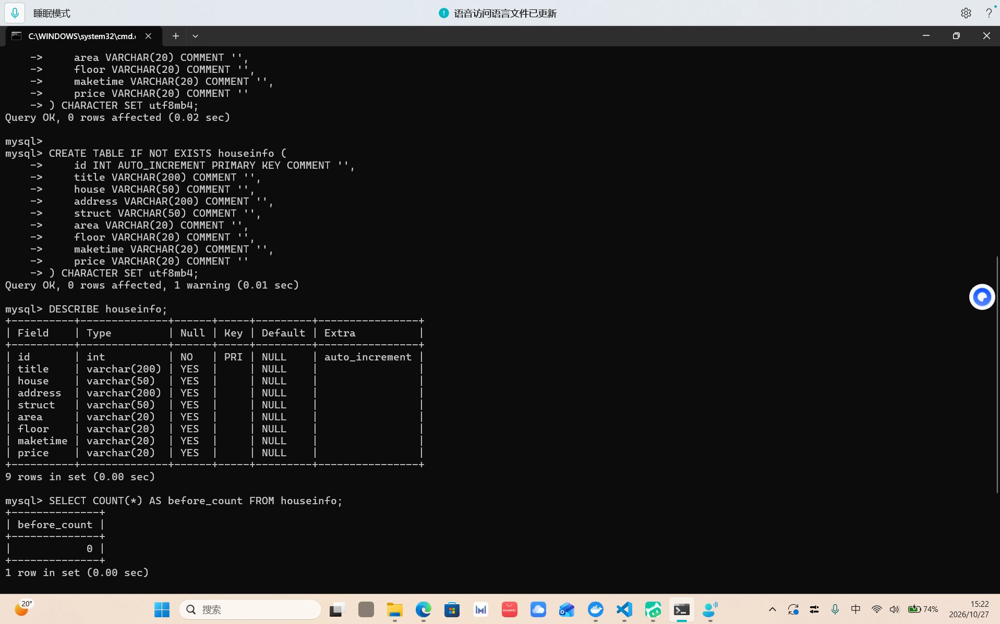
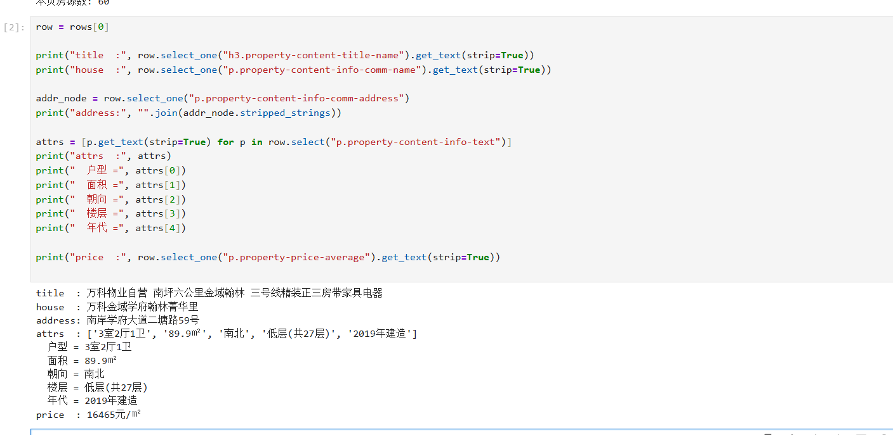
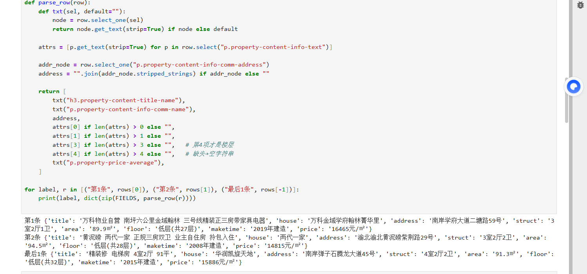
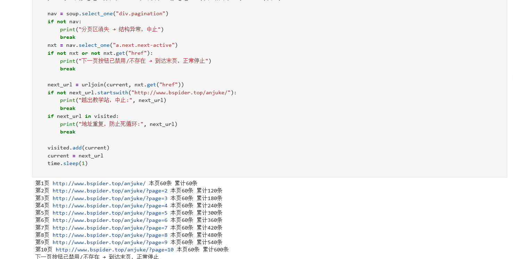
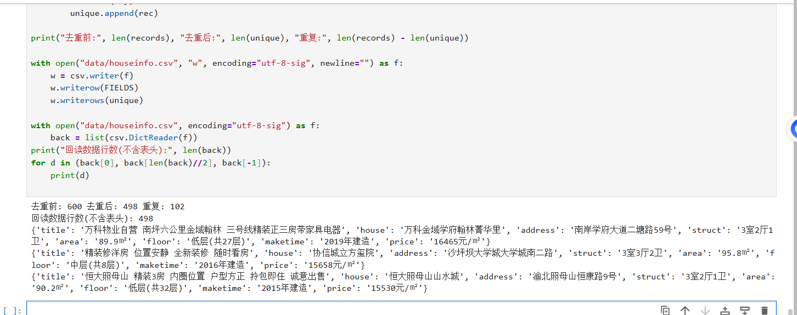
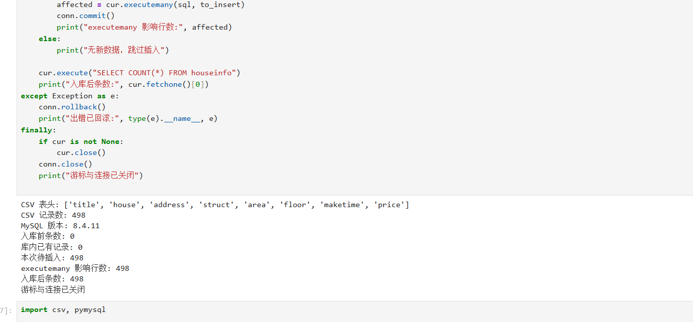
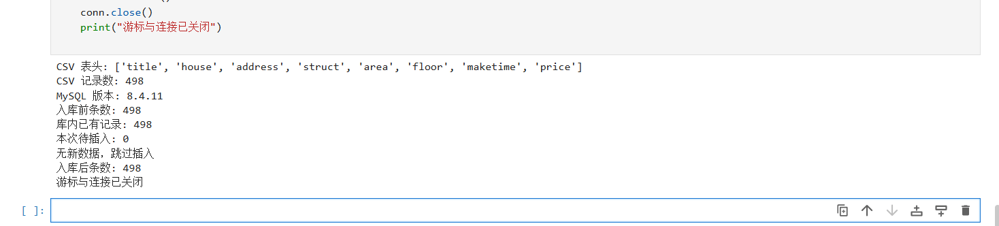
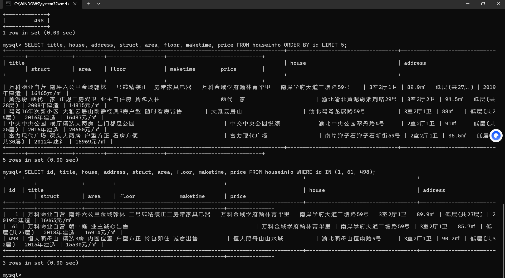

# 实验二报告：房源采集与 MySQL 存储

- 班级：数据1241
- 姓名：王达康
- 学号：112404260133
- 实验日期：2026-10-27
- GitHub 仓库链接：https://github.com/wangdakang-data/bigdata-collection-labs-112404260133
- 源码文件名：anjuke.ipynb
- 数据库与表：`smartpark_lab.houseinfo`
- 数据来源：在线教学站
- 访问时间及结果（若失败，填写状态码、页面标题或报错）：2026-10-27 15:05 访问 `http://www.bspider.top/anjuke/`，状态码 200，页面标题为「重庆二手房房产网，重庆二手房出售，重庆买房购房交易信息 - 58安居客」，首页解析到 60 条房源，非访问验证页。注意：请求必须携带浏览器 User-Agent，否则会返回标题为「访问验证-安居客」的验证页（约 6 KB）。
- 快照文件来源与文件名（在线实验可写"不适用"）：不适用（本次为在线采集）

> 填写要求：截图放在 `images/` 中，在对应位置插入图片。代码截图要显示文件名、行号或单元位置，用红框标出关键代码，每项写2—3句话解释。只截最终结果或只贴 AI 生成的文字，不能代替实验过程。未完成的项目写明原因，不填写预期结果，不展示个人账号密码。

## 第一阶段：MySQL Docker 更新与启动

- 本次是否需要更新：本次按更新包说明更新（导入 `mysql:8.4.11` 镜像并启用 L05 独立教学卷 `smartpark-student_l05-mysql-data`）
- 更新或启动遇到的问题：原课程目录缺少 `.env`，`l05-mysql.ps1` 启动前会强制校验该文件，缺文件时直接 FAIL；已按课程 README 从 `.env.example` 复制并填写学号后启动通过。另外 `CREATE TABLE` 语句重复执行过一次，第二次返回 `1 warning`（表已存在），未影响表结构。

### 启动环境与建表

依次使用 `start-course.bat`、`start-mysql.bat`、`mysql-console.bat` 启动课程环境、数据库和 MySQL 终端。

**截图：** MySQL 启动成功提示，以及终端中 `USE smartpark_lab`、`SHOW TABLES`、`DESCRIBE houseinfo` 的执行结果。可分图。





说明：当前使用哪个数据库？`id` 和8个房源字段分别保存什么？

答：当前使用 `smartpark_lab` 数据库，表为 `houseinfo`。`id` 是 `INT AUTO_INCREMENT PRIMARY KEY`，由数据库在插入时自动生成，用来唯一标识一行，不参与房源内容判断，因此它不能防止同一条房源被重复插入。其余8列与采集顺序一致：`title` 存房源标题，`house` 存楼盘名称，`address` 存拼接后的完整地址，`struct` 存户型（如「3室2厅1卫」），`area` 存建筑面积并保留「㎡」单位，`floor` 存楼层（如「低层(共27层)」），`maketime` 存建造年代，缺失时存空字符串，`price` 存每平方米单价（如「16465元/㎡」），不是总价。面积和单价都用 `VARCHAR` 保存，是为了原样保留网页上的单位和文字，不在采集环节做数值转换。建表后 `before_count` 为 0，说明这是一张新表，后面用它计算本次新增条数。

## 第二阶段：房源采集与 CSV 数据存储

### 1. 网页分析与房源解析

#### 选择器是怎样得到的

在 Chrome 中按 F12，使用 **Elements → Copy → Copy selector**。选一个字段，记录从完整路径到相对选择器的过程。

- 选择的字段：房源标题（第一条房源的 `h3` 节点）
- 复制的原始选择器：
  ```css
  #__layout > div > section > section.list-main > section.list-left > section:nth-child(4) > div:nth-child(1) > a > div.property-content > div.property-content-detail > div.property-content-title > h3
  ```
  （Chrome → Elements → 选中第一条房源的标题 `<h3>` → 右键 Copy → Copy selector 的结果）
- 一条房源的父容器选择器：`div.property`（`soup.select("div.property")` 返回 60 个，与页面房源条数一致）
- 最终使用的相对选择器：`h3.property-content-title-name`（其余字段同理，从 `row` 内部再找，如 `p.property-content-info-comm-name`、`p.property-price-average`）

**截图：** 框出该字段的 HTML 节点和房源父容器，展示选择器的匹配结果。

**〔待补截图：images/01_selector.png —— Elements 面板中选中标题节点、能看出父容器是 `div.property`，并在 Ctrl+F 中看到 `div.property` 匹配 60 处〕**

说明：删掉了哪些层级？怎样确认父容器刚好包含一条房源？

答：Copy selector 复制出来的是上面那条从页面根节点开始的长路径。对照 DOM 可以看出，其中 `div:nth-child(1)` 这一层就是第一条房源的父容器，再往下 `a > div.property-content > div.property-content-detail > div.property-content-title > h3` 是这条房源的内部结构。

删掉了两部分：① 容器以上的 5 层 `#__layout > div > section > section.list-main > section.list-left > section:nth-child(4)` —— 它们只负责"从整篇文档定位到列表区域"，对单条房源没有任何意义，而且带着脆弱的 `nth-child(4)`，页面里多插一个 section 就会失效；② 容器以下的中间层 `a > div.property-content > div.property-content-detail > div.property-content-title` —— 取单个字段时不必逐层写死，直接在这一条房源里按目标节点的 class 找就行。同时把按位置取值的 `div:nth-child(1)` 换成按 class 取值的 `div.property`，把最末尾的 `h3` 换成更明确的 `h3.property-content-title-name`。最终得到相对选择器 `div.property`（父容器）与 `h3.property-content-title-name`（字段）。

确认父容器刚好包含一条房源的方法：把鼠标逐个移到各级父节点上，观察网页高亮区域是否恰好框住一条完整房源（同时包含标题、楼盘、地址、属性和价格，不多也不少）；再从这三个角度交叉验证 —— 第二条房源用的是同一个 class；在 Elements 面板 `Ctrl+F` 输入 `div.property` 显示 60 个匹配，与页面每页房源数一致；Python 里 `len(soup.select("div.property"))` 也正好是 60。三者都对，才能确认这个容器既没有把多条房源包在一起，也没有漏掉字段。

#### 解析8个字段

**截图：** 自己编写的解析代码和首条房源的8个字段输出。代码中必须框出：

- `select()` 和 `select_one()`。
- 面积、单价的定位与取值。
- 建造年代的提取和缺失处理。

可分成几张局部截图。另附面积、单价对应的 HTML 节点或网页原文。





说明：两个选择方法各用在哪里？怎样确认面积和单价没有取错？

答：`select()` 用来"一次取出多个同类节点"，用在整页取全部房源，`rows = soup.select("div.property")` 得到 60 条房源的列表，同时 `row.select("p.property-content-info-text")` 用来取出户型、面积、朝向、楼层、年代这 5 个属性项。`select_one()` 用来"在一个房源内部取唯一的那个字段节点"，用在标题、楼盘、地址、单价等每套房源只有一个的节点上，找不到时返回 `None`，所以取文字前都做了判断。

确认面积和单价没取错的办法：属性组里 5 个 `<p>` 没有各自的 class，只能按顺序取值，打印出来是 `['3室2厅1卫', '89.9㎡', '南北', '低层(共27层)', '2019年建造']`，即下标 0 户型、1 面积、2 朝向、3 楼层、4 年代——特别注意第 3 项「南北」是朝向、第 4 项才是楼层，若按第 3 项取就会把朝向当成楼层。单价取的是 `p.property-price-average`（`16465元/㎡`），不是同级的 `p.property-price-total`（那是 `148万` 总价）；两者一对比单位就能判断：带 `元/㎡` 的才是单价。用第一页第一条在浏览器中逐字比对后，又核对了第二条和最后一条，最后统计了整张 CSV：498 条里 `area` 全部含「㎡」、`price` 全部含「元/㎡」、`floor` 全部含「共」字，说明没有整列取错位。

### 2. 下一页采集

- 下一页 `href` 原值：第一页底部 `<a class="next next-active" href="?page=2">下一页</a>`，即 `href = "?page=2"`（只有查询串，没有主机和路径）
- 用 `urljoin()` 补全后的地址：`urljoin("http://www.bspider.top/anjuke/", "?page=2")` → `http://www.bspider.top/anjuke/?page=2`
- 实际停止原因（明确禁用的末页按钮 / 异常中止）：**正常停止**。第 10 页采集完成后，分页区里已经没有 `a.next.next-active` 这个"启用状态"的下一页按钮，循环按"下一页按钮已禁用/不存在 → 到达末页，正常停止"退出；期间没有出现分页区消失、空列表或地址重复的异常。

**截图：** 框出提取 `href`、补全地址、循环更新地址和停止条件的代码。附前两页的运行日志，以及最终停止提示。离线实验展示快照中的href、补全结果和文件读取记录，注明“离线回放”，不算在线翻页成功。



说明：怎样进入下一页？怎样防止重复采集或无限循环？若中途失败，说明停在哪一步。

答：每页解析完后，在 `div.pagination` 里用 `select_one("a.next.next-active")` 找"启用状态"的下一页按钮，用 `nxt.get("href")` 取出 `?page=2` 这样的相对地址，再用 `urljoin(current, href)` 按当前页地址补全成完整 URL，然后把 `current` 换成新地址进入下一页（这本实验是**在线采集**，不是离线回放）。

防止无限循环和重复采集用了四道判断：① 只认 `a.next.next-active`，末页时该节点不存在或不是 active，直接 `break`；② 用 `visited` 集合记录访问过的地址，`next_url in visited` 就中止；③ 校验 `next_url` 必须以 `http://www.bspider.top/anjuke/` 开头，防止越出教学站（外链或 `javascript:` 地址）；④ 设 `MAX_PAGES = 15` 作为安全上限，达到上限即中止。另外每页之间 `time.sleep(1)`，避免请求过密。本次 10 页全部成功，未出现中途失败；从日志看累计条数按 60、120、…、600 递增，第 10 页后正常退出。

### 3. 保存 CSV

**截图：** CSV保存与回读代码、回读条数。框出编码、表头和数据写入部分。



说明：8个字段的顺序是什么？按8个字段完全相同去重后，保存了多少条记录？

答：8 个字段在 CSV 表头里的顺序是 `title → house → address → struct → area → floor → maketime → price`，与手册要求和 MySQL 建表的列顺序完全一致，这样后面入库时 `DictReader` 可以按字段名取值，不必依赖位置。保存时用 `csv.writer`，文件参数是 `encoding="utf-8-sig"` 和 `newline=""`：`utf-8-sig` 让 Excel 打开不出现中文乱码，`newline=""` 避免 Windows 下多写空行。

去重按"8 个字段完全相同"作为一条记录来判断：把这 8 个值组成元组放进 `set`，只有没出现过的才追加。本次共采集 **600 条**（10 页 × 60 条），其中 8 个字段完全相同的重复记录 **102 条**，去重后保存 **498 条**，回读校验也是 498 行（不含表头）。这 102 条重复来自站点在不同页之间返回了部分相同的房源，属于数据源本身的重复，不是翻页逻辑出错。

## 第三阶段：MySQL 数据存储

### 1. 读取 CSV 并入库

本阶段读取第二阶段的 `data/houseinfo.csv`，不重新采集。





说明：每条记录怎样对应8个参数？成功、失败时分别做什么？再次运行时怎样避免重复插入？

答：用 `csv.DictReader` 读 CSV，按 `FIELDS` 顺序把每行整理成 8 个值的列表，因此每条记录恰好 8 个参数。INSERT 语句里写了 8 个列名（`title, house, address, struct, area, floor, maketime, price`）和 8 个 `%s` 占位符，顺序与列表一一对应；`id` 不写进 INSERT，由数据库自增生成。参数通过 `executemany(sql, to_insert)` 的第二个参数传入，没有用字符串拼接或 f-string，避免引号和注入问题。

成功时调用 `conn.commit()` 提交事务，提交后才能在 MySQL 终端看到新数据；出错时进入 `except` 分支调用 `conn.rollback()` 撤销本次未提交的写入，并打印异常类型和信息；无论成功失败，`finally` 里都先 `cur.close()` 再 `conn.close()` 释放资源，并且因为连接可能没建成功，游标关闭前先判断 `cur is not None`。

再次运行时避免重复插入的做法是：先把库里已有的 8 个字段取出来组成集合 `existing`，再过滤 `to_insert = [r for r in csv_rows if tuple(r) not in existing]`，只插入库里没有的记录。因为 `autocommit=False`，这一读一写处在同一连接里，比较和插入之间不会被自己的数据干扰。实测第一次 `入库前 0 → 待插入 498 → 入库后 498`；关掉程序重跑同一批数据，输出 `入库前 498 / 库内已有 498 / 待插入 0 / 无新数据，跳过插入 / 入库后 498`，条数没有增加，说明去重逻辑生效。整个过程没有用清空表的方式来"重跑"。

### 2. 核对结果

#### 查询条数和样本

**截图：** MySQL 终端中的入库前后 `SELECT COUNT(*)`、重跑后的条数，以及 `SELECT ... LIMIT 5` 的结果。



| 项目 | 实际结果 |
|---|---|
| 成功采集页数 | 10 页 |
| 采集记录数（去重前） | 600 条 |
| 完全相同的重复记录数 | 102 条 |
| CSV数据行数（不含表头） | 498 行 |
| 入库前条数 | 0 |
| 入库后条数 / 本次新增条数 | 498 / 498 |
| 关闭上次程序后，同批数据独立重跑的条数 / 新增条数 | 498 / 0 |
| 是否采集完整；未完成的原因 | 完整：10 页全部采完，末页后「下一页」按钮不再处于启用状态，程序正常停止，无重试失败 |

说明：首次入库后的条数应等于去重后的CSV数据行数，8个字段的内容也应一致。若不一致，说明原因。总条数以实际结果为准。

答：一致。去重后的 CSV 是 **498 行**，首次入库后 `after_count` 也是 **498**，差值为 0；重跑同一批数据后仍是 498，新增 0 条，说明没有重复插入。8 个字段内容也一致：CSV 与数据库逐字段对比了第一条、跨页一条和最后一条，`area` 都带「㎡」、`price` 都带「元/㎡」、`maketime` 都是「xxxx年建造」的原样文本，数据库只是多了一个自增 `id`。因此本次未出现条数或内容不一致的情况。

#### 逐条核对

选取第一条、跨页一条和最后一条，比较网页、CSV与数据库中的8个字段。快照实验对照教师提供的网页文件。

**截图：** 三条样本的对照结果，框出面积、单价和年代。可分图。


> 上图同一条截图的最后一部分是三条样本的对照查询：`SELECT … WHERE id IN (1, 61, 498)`，依次对应第 1 页第 1 条、第 2 页第 1 条（跨页）和第 10 页最后一条。三条的面积分别为 89.9㎡ / 85.7㎡ / 90.2㎡，年代为 2019 / 2018 / 2015 年建造，单价为 16465 / 16914 / 15530 元/㎡，与 CSV 中的对应行完全一致。

- 样本1（页码或URL、记录位置）：第 1 页 `http://www.bspider.top/anjuke/` 第 1 条；CSV 第 1 行数据；数据库 `id=1`。标题「万科物业自营 南坪六公里金域翰林 三号线精装正三房带家具电器」，楼盘「万科金域学府翰林菁华里」，地址「南岸学府大道二塘路59号」，户型「3室2厅1卫」，面积「89.9㎡」，楼层「低层(共27层)」，年代「2019年建造」，单价「16465元/㎡」。
- 样本2（页码或URL、记录位置）：第 2 页 `http://www.bspider.top/anjuke/?page=2` 第 1 条（属跨页样本，第 1 页未出现）；CSV 第 61 行数据（文件第 62 行）；数据库 `id=61`。标题「万科物业自营 朝中庭 业主诚心出售」，楼盘「万科金域学府翰林菁华里」，地址「南岸学府大道二塘路59号」，户型「3室2厅1卫」，面积「85.7㎡」，楼层「低层(共27层)」，年代「2018年建造」，单价「16914元/㎡」。
- 样本3（页码或URL、记录位置）：第 10 页 `http://www.bspider.top/anjuke/?page=10` 最后一条；CSV 最后一行（第 498 行数据）；数据库 `id=498`。标题「恒大照母山 精装3房 内圈位置 户型方正 拎包即住 诚意出售」，楼盘「恒大照母山山水城」，地址「渝北照母山恒康路9号」，户型「3室2厅1卫」，面积「90.2㎡」，楼层「低层(共32层)」，年代「2015年建造」，单价「15530元/㎡」。

核对结论及差异：三条样本在网页、CSV、数据库三处的 8 个字段**完全一致，没有差异**。具体核对的三项重点：面积分别为 89.9㎡ / 85.7㎡ / 90.2㎡，都带「㎡」且是建筑面积不是其他数值；单价分别为 16465 / 16914 / 15530 元/㎡，都是「元/㎡」单价而不是「万元」总价；年代分别为 2019 / 2018 / 2015 年建造，都是「xxxx年建造」原文。CSV 行号与数据库 `id` 的对应关系也能对上（CSV 第 61 行数据 ↔ `id=61`），说明入库没有打乱顺序、也没有丢行。

## 问题与解决

- 遇到的问题、处理方法及结果（没有可写“无”）：① 按手册直接请求教学站，返回的是标题为「访问验证-安居客」的验证页（约 6 KB），拿不到房源。排查后发现是请求头缺少浏览器 User-Agent，在 `requests.get()` 里加上 `User-Agent: Mozilla/5.0 … Chrome/120` 与 `Accept-Language` 后正常返回 280 KB 的真实房源页，状态码 200，首页 60 条。② 连续请求时偶发 `ReadTimeout`，4 次里会失败 1 次；为此写了 `get_page()` 做最多 4 次重试（每次间隔 2 秒），并在每页之间 `time.sleep(1)`，之后 10 页全部成功。③ 建表前后 `CREATE TABLE` 执行了两次，第二次返回 `1 warning`，原因是表已存在；用 `CREATE TABLE IF NOT EXISTS` 后不报错，表结构未受影响。④ Notebook 另存时文件名变成了 `anjuke.ipynb.ipynb`，已改名回 `anjuke.ipynb`。
- 尚未解决的问题、未完成的步骤（没有可写“无”）：采集与入库部分已全部完成，10 页 498 条数据已入库并核对一致。报告中「Copy selector 原始结果」一栏已填写（完整路径与 `div.property`、`h3.property-content-title-name` 的推导过程见上文），该处配套的 Elements 面板截图待补，属于浏览器截图整理工作，不影响任何数据结果。

## 思考题

1. 本次怎样实现下一页采集？结合自己的代码说明。

   答：每页解析完后，在 `div.pagination` 中找"启用状态"的下一页按钮 `a.next.next-active`，用 `nxt.get("href")` 取出原值 `?page=2`（只有查询串，没有域名和路径），再用 `urljoin(current, href)` 以当前页地址为基准补全成 `http://www.bspider.top/anjuke/?page=2`，然后把这个完整地址赋给 `current` 进入下一页，循环条件写的是 `while current and page_no < MAX_PAGES`。停止条件有两类：正常的停止是末页时 `a.next.next-active` 不存在或没有 `href`，说明"下一页"按钮已被禁用，直接 `break` 并打印"到达末页，正常停止"；异常的停止是分页区整体消失（记为结构异常）、`next_url` 越出 `http://www.bspider.top/anjuke/`、或地址已在 `visited` 集合里出现过。本次跑到第 10 页后按钮消失，属于正常停止，不是中止。

2. 旧代码把 out_list 定义在全局。你把结果列表放在哪里？为什么？

   答：8 个字段的解析被收进 `parse_row(row)` 函数里，函数只负责解析"一条房源"并 `return` 一个 8 元列表，不碰任何全局列表，也不做隐式累加；采集用的 `records = []` 写在采集循环所在的单元里，并且在 `while` 之前显式初始化为空列表。这样做的好处：一是重新运行这个单元时 `records` 会被重新赋值，不会把上一次运行的数据累加起来（否则条数会越跑越大，去重前后数字全错）；二是 `parse_row()` 变成可单独测试的纯函数，`parse_row(rows[0])` 就能直接和第 1 条房源对照，出问题容易定位到是选择器错了还是循环错了；三是函数不依赖外部变量名，循环里 `for r in page_rows: records.append(parse_row(r))` 的意图一眼能看清。

3. 你怎样获取建造年代？节点缺失或顺序改变时，怎样处理？

   答：建造年代没有独立的 class，它和户型、面积、朝向、楼层一起放在 `div.property-content-info` 下的 5 个 `p.property-content-info-text` 里，我按顺序取出列表 `attrs`，年代取 `attrs[4]`（第 5 项），并在前面确认过这一页 60 条都是 5 项、顺序为 `0=户型 1=面积 2=朝向 3=楼层 4=年代`。处理缺失和顺序变化时用了两道保护：① 取值前先判断长度，写成 `attrs[4] if len(attrs) > 4 else ""`，节点或列表项不存在时返回空字符串，不会抛 `IndexError`——手册要求缺失时填空字符串，这样入库后该列就是空值，不会把 `None` 或上一行的值带进来；② 只判断"列表非空"是不够的，因为列表非空但只有 4 项时 `attrs[4]` 照样越界，所以必须判断长度是否大于 4；③ 取到值后再核对文本格式（应为「xxxx年建造」），如果某次取到的内容不是这个格式，说明顺序变了，应停下来检查选择器而不是直接入库。本次 498 条记录的年代全部正常取到，没有出现空值。

## 提交检查

- [ ] 实验一原仓库的 `lab02/` 中已有源码、CSV、报告和真实截图。
- [ ] 截图清楚，关键代码已框出，每项附有个人解释。
- [ ] GitHub上能打开文件和图片，未上传个人账号密码、`.env`或教师答案。
- [ ] 未完成项已如实说明；学习通只交原仓库链接。

如使用 AI，简述它帮助了什么，以及自己修改、运行和核对了什么：本次使用 AI 助手协助理解实验手册、排查环境问题（MySQL 增量包的镜像导入、`.env` 缺失导致启动检查不通过）和提供代码思路。所有代码都由本人在 JupyterLab 中逐格运行并核对输出：首页 60 条、10 页共 600 条、去重后 498 条、入库 498 条、重跑新增 0 条，均与 AI 给出的预期数值一致；字段解析结果与浏览器页面上第一条房源逐字比对过，面积、单价、楼层、年代四项特别核对，确认没有把朝向当楼层、没有把总价当单价。报告中每段说明按本人实际观察和运行结果改写，未直接照搬生成的文字。
